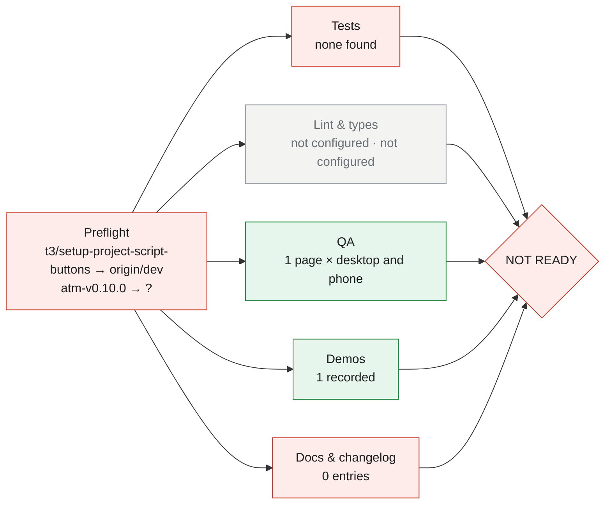

# Ship unversioned · t3/setup-project-script-buttons

> **NOT READY**: 3 things to settle first. Generated by `ship` on 2026-11-08 05:27. Nothing was committed, tagged, pushed, published or deployed.

Report: http://127.0.0.1:8765/atm/t3-setup-project-script-buttons-ship.html

## Summary

`t3/setup-project-script-buttons` → `origin/dev` in **atm**: 0 commits since origin/dev, 2 files, +0 −0.

## Version

| Current | Proposed | Bump | Why |
|---|---|---|---|
| atm-v0.10.0 (tag atm-v0.10.0) | **–** | – | no commits to release |

## Changes

### [Unreleased] - 2026-11-08

_No commits since origin/dev._


## What was verified



## Completeness

**Documentation**

- [x] Ship doc: docs/ship/2026-11-08-t3-setup-project-script-buttons.md
- [ ] Changelog entry: no commits since origin/dev — to fix: commit the work first
- [x] README / docs updated: docs/specs/project-script-buttons.md, docs/specs/project-script-buttons.spec.json

**Testing**

- [ ] Tests: no test command found — to fix: add tests, pass --test-cmd, or --accept "tests: why"
- [x] Lint: not configured (n/a)
- [x] Typecheck: not configured (n/a)
- [x] QA: 1 page × desktop and phone

**Demos**

- [x] docs/specs/project-script-buttons.md: desktop · 14s

**Basics**

- [ ] Work committed: 2 uncommitted: docs/specs/project-script-buttons.md, docs/specs/project-script-buttons.spec.json

## Tests

No test, lint or typecheck command found. Pass `--test-cmd`, or accept it with `--accept "tests: reason"`.

## QA

| Page | Width | Load | Problems | Screenshot |
|---|---|---|---|---|
| docs/specs/project-script-buttons.md | desktop 1000px | 278 ms | ✅ none | [qa-docs-specs-project-script-buttons.md-desktop.png](http://127.0.0.1:8765/atm/ship/t3-setup-project-script-buttons/qa-docs-specs-project-script-buttons.md-desktop.png) |
| docs/specs/project-script-buttons.md | phone 390px | 152 ms | ✅ none | [qa-docs-specs-project-script-buttons.md-phone.png](http://127.0.0.1:8765/atm/ship/t3-setup-project-script-buttons/qa-docs-specs-project-script-buttons.md-phone.png) |

## Demos

### docs/specs/project-script-buttons.md

Before, this doc did not exist. After, it is a full spec for adding four T3 project-script buttons. The spec covers the problem, goals, workflow diagram, spec table, acceptance criteria, edge cases, risks and open questions.

- desktop (1000×800, 13.8s): [video](http://127.0.0.1:8765/atm/demos/t3-setup-project-script-buttons-docs-specs-project-script-buttons-desktop.mp4) · [poster](http://127.0.0.1:8765/atm/demos/t3-setup-project-script-buttons-docs-specs-project-script-buttons-desktop.jpg) · `/Users/jmac/.claude/pr-previews/atm/demos/t3-setup-project-script-buttons-docs-specs-project-script-buttons-desktop.mp4`

Try it yourself:

1. Open the rendered doc: http://127.0.0.1:8765/atm/docs/t3-setup-project-script-buttons-docs-specs-project-script-buttons-after.html
2. Added spec for four project-script buttons
3. Added problem: bare shell, local-only server
4. Added button-click to preview-tab workflow diagram
5. Added five rules for PATH, bind, playwright
6. Added six testable acceptance criteria
7. Compare with the base version: http://127.0.0.1:8765/atm/docs/t3-setup-project-script-buttons-docs-specs-project-script-buttons-before.html

## Bugs

None found.

Machine-readable: `/Users/jmac/.claude/pr-previews/atm/t3-setup-project-script-buttons-bugs.json`

## Questions for you

- This repo has no `CHANGELOG.md`. Create one starting with the entry above? (ship won't create it on its own.)

## Risk notes

- **low**: No code changes: 2 files of docs, tests or metadata.

## Rollback plan

1. Nothing is released until you run the commands above, so before that there is nothing to roll back.
2. After merging: `git revert -m 1 <merge commit>` on origin/dev (or `git revert <sha>` for a squash merge), then ship a patch release.

## Ship it (commands for you; ship ran none of them)

```sh
# Commit the ship doc
git add docs/ship/2026-11-08-t3-setup-project-script-buttons.md && git commit -m "docs(ship): 2026-11-08 ship report"
# Open a draft PR to merge it
git push -u origin t3/setup-project-script-buttons && gh pr create --draft --base dev --fill
```

After you ship, watch CI and deployments: `python3 -I /Users/jmac/.claude/skills/pr-preview/scripts/deploy_status.py --watch` (current page: http://127.0.0.1:8765/atm/t3-setup-project-script-buttons-deploy.html)

## Sign-off

- [ ] I read the changelog and the version is right
- [ ] I watched the demos and tried one myself
- [ ] Tests and QA results are acceptable
- [ ] Risk notes and rollback plan make sense
- [ ] I'll run the ship commands myself
