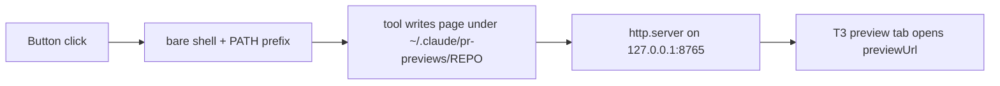

# Project-script buttons for the atm project

> Set up the standard project-script buttons (Spec progress, Preview PR, Deploy status, Ship pre-flight) for this T3 project on this MacBook, matching the setup on Blue's Mac mini.

## Problem
Reviewing, previewing and shipping work in `atm` means remembering four terminal commands and where their pages are served. On the MacBook the browser is local, so the page server must not be reachable from the LAN or NetBird, and T3 runs buttons in a bare shell where `node`, `bun` and Homebrew are not on PATH.

## Goals / Non-goals
- Goals
  - One button each for Spec progress, Preview PR, Deploy status and Ship pre-flight.
  - Every command works in T3's bare shell and opens its page in T3's browser tab.
  - The page server listens on `127.0.0.1` only.
- Non-goals
  - Exposing port 8765 on the LAN or NetBird (on hold with Jmac).
  - Fixing T3 Code itself.

## Users & scenarios
- **Jmac, mid-review:** clicks Preview PR in a thread and sees before/after screenshots.
- **Jmac, before merging:** clicks Ship pre-flight and reads the READY / NOT READY verdict.
- **Jmac, starting a feature:** clicks Spec progress and sees which criteria are built, tested and shipped.

## Workflow

## Spec table
| ID | Rule | Limit | Inputs → outputs |
|---|---|---|---|
| R-1 | Each command starts with the bare-PATH prefix | `$HOME/.local/bin:$HOME/.bun/bin:/opt/homebrew/bin` | button click → tool found |
| R-2 | The page server binds loopback only | `PR_PREVIEW_BIND=127.0.0.1` in every command | tool run → listener on 127.0.0.1:8765 |
| R-3 | previewUrl uses `http://127.0.0.1:8765/<repo>/…` | no LAN or NetBird address | button → page opens locally |
| R-4 | Screenshot tools use T3's bundled playwright-core | `PLAYWRIGHT_CORE` set to the app bundle path | Preview PR / Ship → screenshots |
| R-5 | Scripts are added through the app UI | T3 ignores `settings.json` edits and MCP writes (pingdotgg/t3code#14991) | UI save → script in menu |

## Acceptance criteria
- **AC-1** Spec progress, Preview PR, Deploy status and Ship pre-flight each exist in the atm project's scripts menu.
- **AC-2** Each command runs under `env -i … PATH=/usr/bin:/bin:/usr/sbin:/sbin` without "command not found".
- **AC-3** `lsof` shows port 8765 listening on `127.0.0.1` only, and the Mac's LAN address refuses the connection.
- **AC-4** Each button's previewUrl returns HTTP 200 after the button has run in the same checkout.
- **AC-5** Preview PR and Ship produce screenshots, not "screenshots failed".
- **AC-6** Spec progress renders a page for this spec.

## Edge cases
| Case | What happens |
|---|---|
| Button runs in a worktree thread | Pages go under the worktree's folder name, not `atm`, so `/atm/` URLs show stale pages |
| No spec in the checkout | Spec progress exits with "no spec found" and its page 404s |
| T3 Alpha app moved or renamed | `PLAYWRIGHT_CORE` path breaks; screenshots fail |

## Risks
| Risk | Mitigation |
|---|---|
| Port 8765 exposed by a stray default bind | `PR_PREVIEW_BIND=127.0.0.1` in every command; check with `lsof` |
| Stale pages mistaken for fresh ones | Open the page from the checkout that ran it; check its timestamp |

## Open questions
- Q1 below: how previewUrls should map onto worktree folders.

## Out of scope
- NetBird check button.
- A narrowed, allowlisted page server.
