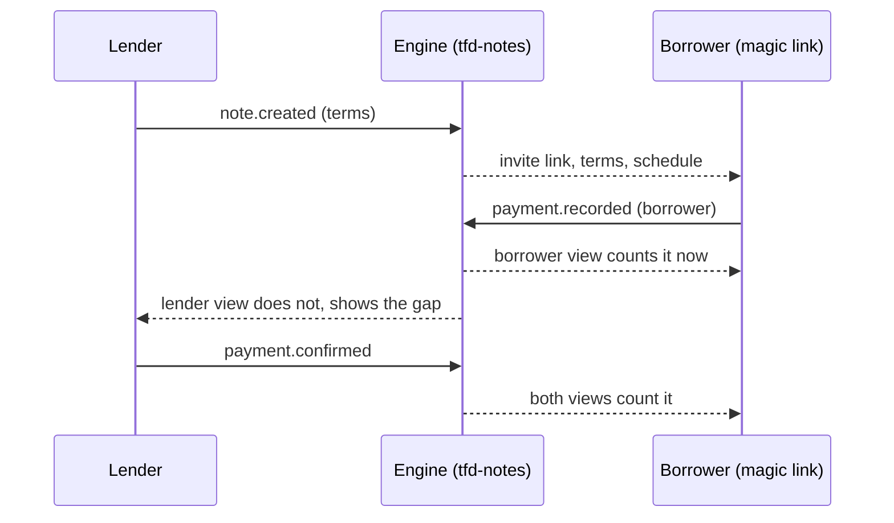

# Promissory notes: a shared record of a loan, its schedule, payments and receipts

> Trifold should let a lender and a borrower keep one append-only record of a loan: the terms, the schedule they agreed,
> every payment, and each side's acknowledgment of it. The engine computes every balance; a person records and confirms
> every fact; a number anyone can recompute with an Apache-2.0 library.
>
> Status 2026-11-22: build steps 1 to 5 are built, as the library halves (`packages/tfd-notes`, `packages/verify-notes`)
> and the hosted halves (`apps/trifold-cloud/src/notes`). The hosted code is staging-only: nothing is deployed, no mail
> provider is chosen, the secrets are not created. Step 6 is later.

## Problem

Family, co-op, church and school loans live in texts, a spreadsheet and memory. When the lender says $6,550 is left and
the borrower says $6,200, nobody can show where the $350 went: a payment that was never confirmed, a past payment never
written down, interest worked out two ways. A note record that only one side keeps shows nothing to the other. The
record has to be shared, show each side's own count, and say what is confirmed and what is only claimed.

## Goals / Non-goals

Goals:
- One append-only event stream per note: terms, schedule, payments, confirmations, disputes, annotations, notices,
  releases, approvals and sharing, in a hash chain with signed documents (receipt, payoff statement, release, seal).
- Engine-computed balances, accrued interest, expected-vs-paid and days overdue; every figure replays from the events.
- Show the lender's balance, the borrower's balance and the itemised difference. Never decide the truth for them.
- Past payments can be backfilled and are labelled as claims until the other side confirms them.
- The calculator is Apache-2.0 and runs in browsers, Workers and Bun, so anyone can recompute a statement.
- A counterparty needs no account: a magic-link guest view (decided 2026-11-12).
- A lender can be an organization that acts through agents, with two-person approval for the steps that matter.
- A note can be shared with a named person or a verify link, only with what both parties count the same (R-36 to R-40).

Non-goals (this spec; later milestones in the build order):
- A public tier, pseudonyms and per-event audiences (the reviews cut them from v1). Grant levels (summary, statement,
  verify) are built.
- Late fees, default rates, collateral, guarantors, assignment, structured forbearance, foreign currency.
- Rifo drafting. Rifo is not shipped; the engine and the people work without it.
- Legal advice or any claim that a record is enforceable (see Claim limits).

## Users & scenarios

- **Maria, a lender**, lent Ana $10,000 at 5%. She records the note, records the payments Ana hands her, and confirms or
  disputes the ones Ana records.
- **Ana, a borrower**, opens a magic link on her phone, sees the terms and her balance, records a $350 payment with a
  photo of the transfer, and sees Maria's count beside her own until Maria confirms.
- **A co-op treasurer** tracks a dozen member loans as the lender's agent (role `treasurer`), sees the portfolio with
  aging, and asks a board member to approve a release or a default notice. A **board member** (role `board`) also
  approves, never their own request. A **viewer** only reads.
- **A guest** is anyone who opens an emailed link without an account: a borrower, or a lender who is a person.
- **A share viewer**, such as an accountant, is shown a read-only view by one party, with the other party's agreement
  or, for a typed disclosure, with the other party told (R-37). The viewer sees only what both parties count the same.

## Workflow

## Spec table

| ID | Rule | Limit | Inputs → outputs |
|---|---|---|---|
| R-1 | A note is a stream of `tfd.note-event.v1` events with a per-note `seq` starting at 1 with no gaps; everything else is derived by replay | The hash chain (R-32) and the signed seal (R-34) sit over the stream; the stream alone is not signed | events → statement |
| R-2 | Money is an integer count of minor units carried as a digit string; the currency code and its decimal exponent are in the terms; no floats anywhere | Exponent 0 to 4 | terms → amounts |
| R-3 | A rate is a decimal string of at most 6 places and under 1, i.e. under 100% a year (`"0.0525"`, `"0"` allowed), parsed exactly; interest is exact rational arithmetic on `bigint` | No `Number` in any money or rate path | rate → rational |
| R-4 | Interest is simple, daily, actual days over 365, on principal outstanding; interest never accrues on interest | One day count in v1 | balance, dates → interest |
| R-5 | Interest accrues exactly. At each installment date and at each report the interest due is the exact accrued amount rounded half up (never below zero); a payment covers it first, and the exact remainder, positive or negative, carries forward. A schedule is what the statement replay shows if every row's payment is made on its due date | The rounding point is part of the contract | interest → minor units |
| R-6 | Dates are civil `YYYY-MM-DD`; the engine does no time-zone work; the caller turns a recorded instant into a date with the note's IANA zone. The one place the engine reads an instant is the age of an unanswered event, which uses the UTC date of `entered_at` | Zone lives in the terms; the age can differ by a day from the note's local date | instant, zone → date |
| R-7 | Schedule types: `amortized` (weekly, biweekly or monthly, `count` installments from `first_due`), `custom` (an explicit list of due dates and amounts, so balloon and interest-only fit) and `none` (informal) | Monthly dates anchor on the first due day and clamp to month end | terms → schedule |
| R-8 | The amortized level payment is the smallest whole minor-unit payment for which installments 1 to `count − 1`, simulated with the R-5 carry, leave a final installment no larger than the level payment; the final installment absorbs the rounding; row payments are capped at what is owed and unpaid interest is never added to principal | Found by exact integer search; `count` at most 5200 | terms → payment, rows |
| R-9 | A payment applies to the accrued unpaid interest first, then to principal; any amount beyond the payoff is reported as `overpaid`, not applied | No fee bucket in v1 | payment → split |
| R-9a | A reversal (a bounced check) undoes one whole payment: it must equal that payment's amount, be dated on or after it, and makes the statement read as if the payment never happened, so the interest it covered accrues again; a payment is reversed at most once; a reversal counts in a view when that view counts any positive amount for it, and then undoes the whole payment; a counted reversal gets its own difference row showing minus the payment amount, and the payment keeps its row, so the rows net to the payoff gap | Partial reversals are a later milestone | reversal → view |
| R-10 | A fact that hurts the party who recorded it counts in both views at once; a fact that helps the recorder counts in the recorder's view only until the other party confirms it | A borrower payment and a lender reversal help their recorder; a lender payment and a borrower reversal hurt theirs | event → view membership |
| R-11 | A dispute names a counter-amount and a reason, and moves only the disputing party's view to the counter-amount; a bare "disputed" is refused. A resolution takes effect only when both parties have entered `payment.resolved` for that payment with the same agreed amount since the last dispute; until then the dispute stands. A party may later confirm a payment it disputed (withdrawing the dispute); a `payment.resolved` filed when no dispute stands is ignored, and a party's latest filing since the last dispute is the one that counts | The recorder's view keeps the original amount until a resolution | dispute → view |
| R-12 | There is no deemed confirmation and no "confirm the balance" action: a confirmation covers one event; an unanswered event shows as unanswered with its age | No timer changes any number | event → status |
| R-13 | `payment.recorded` carries two dates, the `value_date` (when it is said to have happened) and `entered_at` (when it was entered), plus who entered it | `entered_at` is the caller's clock until the witness exists | event → provenance |
| R-14 | A backfilled payment has `source: lender-states` or `borrower-states`, carried on the event and on its difference item; "both agree" is derived from the counterparty's confirmation and is never typed or stored | A confirmation is "confirmed by the holder of an email address" (R-21), not a signature | event → label |
| R-15 | The statement for an `as_of` date returns the schedule, the lender view, the borrower view, the itemised difference, expected-vs-paid, days overdue and the engine version | Pure function: no clock, no store | events, date → statement |
| R-16 | Expected cumulative is the sum of installments due on or before `as_of`; overdue is `expected − paid` when positive and never more than the view's payoff, counted in days from the earliest due date whose cumulative expected exceeds paid; a paid-off note is never overdue | `none` schedules are never overdue | schedule, payments → overdue |
| R-17 | The library is Apache-2.0, zero dependencies, with no `node:` import, `Buffer`, `eval` or `new Function`, so it runs in Bun, Node, Workers and browsers | Enforced by a test | n/a |
| R-18 | Test vectors under `tests/golden/` are CC0-1.0 and are the cross-language contract | A second implementation must reproduce each expected file's values exactly (compared as parsed JSON) | vectors → engine |
| R-19 | An unlabelled claim never reads as settled: statements say "confirmed", "claimed by lender", "claimed by borrower", "disputed" | Wording follows `AGENTS.md` claim rules | statement → text |
| R-20 | **Magic-link guest.** Each party gets its own emailed link: a 256-bit token whose hash is stored, valid 7 days, used once. A GET shows a page with one button and redeems nothing (mail scanners fetch links); the POST redeems and opens a session. A session ends after 2 hours idle or 12 hours in all. The cookie is `__Host-tf_note_<note id>` (`HttpOnly; Secure; SameSite=Lax; Path=/`, no `Domain`), one name per note, so a sibling host cannot set or shadow it and one note's cookie is never read as another's. Every form carries a CSRF token, an HMAC of the session under `NOTES_SESSION_SECRET`. Asking for a new link shows the same page for any address and is limited to 3 per address and 10 per note per hour | Hosted, staging only (404 elsewhere); no mail provider yet, so no link has been sent | link → session |
| R-21 | A page says who confirmed something only as "confirmed by the holder of <masked email>", for example `a**@e******.com`. It never says "signed" or "signature": a person opened a link sent to that address (decided D2). An event carries `via: "email-link"` or `"account"`, set by the server | Guest confirmation rests on control of an email address | event → text |
| R-22 | **Step-up email codes.** These steps need a fresh 6-digit code mailed to the person acting: `terms.accepted`, `payment.disputed`, `payment.resolved`, `release.confirmed`, a `default` notice, and consenting to a share. A code works for one kind of step, once, for 10 minutes. Tries are counted per session and step over an hour, 5 at most, and a new code does not reset the count; at most 5 codes are mailed per session per hour, so asking for codes buys no more guesses. The code hash is keyed by `NOTES_SESSION_SECRET` | A code proves email control only | step → code |
| R-23 | **Release.** The lender drafts a release (`release.drafted`), then confirms it (`release.confirmed`, naming the draft) no sooner than 24 hours after the draft and with a step-up code. The signed release says "The lender states this note is released." with the lender's payoff that day and `released_with_balance` when it is above zero; it never says the note was paid. A release changes no balance | The 24 hours is the hosted default; the library only requires the confirmation not to precede the draft | draft → release |
| R-24 | **Notices.** A `reminder` carries no cure period; a `default` notice carries `cure_days` (0 to 365) and a step-up code. Both are the lender's, at most 5 a day per note. A notice mails the borrower a plain "a notice was recorded" email with no amount. A notice never changes a balance, a status or an overdue figure | A notice is a record that one was sent, not a finding | notice → record |
| R-25 | **Declined terms.** The borrower may enter `terms.declined` ("Not my loan"); the last of `terms.accepted` and `terms.declined` decides `state.terms` (`proposed` until one exists). While it stands as declined, a new `payoff.issued`, any `notice.sent` and an `approval.requested` for `notice.default` are refused. Payments, confirmations, disputes, annotations and releases still go through. The portfolio leaves a declined note out of outstanding, overdue and the aging buckets (shown `current`, 0 days, flagged `declined`) | A payment may still be recorded before terms are accepted (informal mode) | events → state |
| R-26 | **Organizations.** The lender may be an organization that acts through agents it registered by email, each with an opaque `agent_ref` stamped on every event the agent enters. Roles: `treasurer` (reads, records, drafts, confirms, sends, asks for approval), `board` (the same, and approves, never their own request) and `viewer` (reads; every step answers `wrong_role`). A role applies to the whole organization, not to one note. The `agent_ref` is per note, so two notes show an agent under two refs. Pages say "the lender's team" and never show a ref or an address | Hosted: only the lender side may be an organization | agent → role |
| R-27 | **Two-person approval.** For an organization, `release.confirm`, `notice.default` and `waiver` need an `approval.requested` from one agent and an `approval.granted` from a different active agent (in the hosted service, a board member); the requester never approves their own request, and a request with no `agent_ref` is never satisfied. The cooling-off and the step-up code still apply to the agent who confirms | A person lender has an empty policy | events, policy → allowed |
| R-28 | **A default notice names its approval.** The `approval.requested` for `notice.default` carries `cure_days` (0 to 365; refused on other actions). When the policy needs two people, the `notice.sent` must carry `approval`: a satisfied request, used by no other notice, with equal `cure_days`, entered no later than the notice and at most 30 days before it. A reminder never carries one | The 30 days is `APPROVAL_MAX_AGE_DAYS` | request, notice → allowed |
| R-29 | **A waiver changes no number.** v1 has no event that forgives money. A waiver approval records `approval.requested`, `approval.granted` and an `annotation.added` saying that two people approved it and that no balance changes; the statement is the same before and after | Forgiveness as a number is a later milestone | approval → annotation |
| R-30 | **Portfolio.** One row per note, read through the organization's role: payoff, overdue, days overdue, aging, notes awaiting confirmation, disputes, terms state, closed, next due date. Totals are per currency and exponent, never added across them. A note that cannot be read goes to `invalid` and the rest still compute. Rows sort by days overdue, then note id | Hosted reads at most 500 notes; paging is not built | notes, date → rows, totals |
| R-31 | **Aging buckets** by days overdue: `current` (0 or less), `1-30`, `31-60`, `61+`. A closed note, a declined note or a payoff of 0 is always `current` with 0 days | One view per row | days → bucket |
| R-32 | **Board report and CSV.** The report carries only: note id, currency, exponent, role, payoff, overdue, days overdue, aging, counts of awaiting and disputed, terms, declined, closed, next due, and the totals; and how many notes could not be computed. It never carries free text, dispute reasons, notice contents, agent refs, event ids or addresses. The CSV has a fixed header, RFC 4180 quoting and `\n` line ends; a text cell starting with `=`, `+`, `-`, `@`, a tab or a carriage return gets a leading `'`; numeric cells must be integers or the export fails | For treasurer and board roles only; a viewer gets none | portfolio → report |
| R-33 | **Hash chain.** One link per event in `seq` order: `seq`, `event_id`, `event_hash` (sha256 of the event's canonical JSON) and `prev_hash`. Link 1 names the genesis hash, sha256 of `tfd.note-chain.v1:` and the note id; each later link names the hash of the one before. Editing, reordering, dropping or inserting an event changes every later link. `verifyChain` reports which check failed and at which `seq` | A chain alone shows consistency, not who stood behind it (R-35) | events → links |
| R-34 | **Signed documents.** Four, each with no name or email (parties are opaque references of letters, digits and `._:-`): a payment receipt (one payment, its event hash, its status wording at the time of issue, each view's payoff on its value date), a payoff statement (both views' principal, interest and payoff, and the gap, with a wording line), a release (R-23) and a chain seal (note id, head seq, head hash, time). Receipt, payoff and release are signed with the existing `receipt` key purpose, the seal with the `seal` purpose; no new key or purpose. Every body names the chain head it was made against. A payoff statement is named by hash in `payoff.issued` | Keys and key ids come from the Worker; unset, document steps answer 503 and sign nothing | events → documents |
| R-35 | **The offline verifier rule.** `verifyNoteBundle` is `ok` only when the chain verifies, every document verifies and fits the chain, and a verified `note.chain-seal` names the chain's head (its `head_seq` the number of links and its `head_hash` the recomputed head). Otherwise the verdict says `chain_unsealed`, `chain_seal_stale` (with how many events follow the seal) or `chain_seal_mismatch`. `verifyNoteChain` alone is structural: anyone can edit an event, rebuild every link and pass | A pass says the signature verifies for that key and the file is unchanged since signing, not that the facts are true | bundle, keys → verdict |
| R-36 | **Sharing (D1).** The audience is set per note and starts as the two parties. A share to anyone else is proposed by one party, counts as that party's consent, and is active only when the other party also consents, with a step-up code. Either party may revoke any share at any time. A share needs `expires_at`, at most 365 days after it is proposed (the hosted default is 30). An expired or revoked share is never active. There is no public tier | The audience is the pair, not one party | grant events → who may read |
| R-37 | **Carve-out, a typed exception to D1.** Either party may disclose to one `person` for a stated purpose: `accountant`, `lawyer`, `court` or `assignee`, at level `summary` or `statement`, for at most 90 days. It is active on the proposer's consent alone. The other party is emailed, and the disclosure log lists every carve-out to both parties whatever its status. Anything else widening the audience still needs both parties | The owner may drop the exception (Open questions) | proposal → active grant |
| R-38 | **Negative events never leave the two parties.** A shared view is built only from what both views count the same, so a dispute, an unanswered claim, a counter-amount, an age, a notice, an annotation, an agent or a name is not an input. A `link` audience gets level `verify` only. Revoking shows this exact sentence: "Revoking stops later reads. It cannot take back what the person already saw." | A viewer who looks twice can infer a change (Known limits) | events → shared view |
| R-39 | **What a share viewer sees.** `verify`: the note id and nothing about money, state or parties. `summary`: the as-of date, currency, open or closed, principal, interest and payoff on the agreed count, the schedule's length and the next due date. `statement`: also the schedule rows and the agreed payments (position, value date, amount, kind; no event id), labelled "recorded and counted by both parties". The grant is read again on every request | Read-only; the cookie is `__Host-tf_share_<note id>_<grant id>`, lasts at most 12 hours and never past the grant | grant, level → view |
| R-40 | **The verify-link page.** A bearer token in the path opens a page where a person pastes one signed document (64 KB at most; checked, not kept) and sees whether its signature verifies against the published keys (`NOTES_PUBLIC_KEYS_JSON`). It shows no amount, party, balance or list of documents. Unset, it says the check is not configured and points to `tfd-verify-notes` | The check runs on our server; an independent check uses the verifier package | document → verdict |
| R-41 | **"Closed".** A party's own statement closes on `release.confirmed` and reopens on a reversal recorded after it with a value date after the release's UTC date. A shared view follows only the events both parties count, so a reversal one party has not yet answered does not reopen it there. The two can differ for a moment | Neither changes a balance: a closed note still shows both counts | events → `state.closed` |
| R-42 | **No personal data in events.** Events carry opaque references (`agent_ref`, a share's audience ref), salted commitments (`contact_commitment`) and hashes, never an email or a name; addresses live only in the note's own Durable Object and, for organizations, as salted hashes in the cross-note index. Free text (annotation text, dispute reason, payment method and reference, `agent_ref`) refuses control and bidirectional characters; an annotation is visible to both parties and stays in the bundle | An annotation is the parties' own words and cannot be removed without breaking the chain | event → store |

## Event set

Every type below is implemented in `tfd-notes` (validator, `schema/note-event.v1.json`, golden vectors). Any event may
also carry `via` (`email-link` or `account`) and `agent_ref` (an opaque id of at most 128 characters, never a name or an
email); the hosted service sets both, a client cannot send them.

| Type | `entered_by` | Fields and rules |
|---|---|---|
| `note.created` | the lender in the hosted API | terms, parties' roles, optional signed-document hash; first event only |
| `payment.recorded` | either | amount, `value_date`, method, reference, `kind` (`payment` or `reversal`), `reverses`, `source` (R-9a, R-10, R-13, R-14) |
| `payment.confirmed` | the party that did not record the payment | `target`: one payment; covers that event only |
| `payment.disputed` | the party that did not record the payment | `target`, `counter_amount_minor`, `reason` (R-11) |
| `payment.resolved` | either | `target`, `agreed_amount_minor`; counts only when both parties file the same amount |
| `annotation.added` | either | text, optional attachment hash and `target`; no number changes |
| `terms.accepted`, `terms.declined` | the borrower | no fields; the last of the two decides `state.terms` (R-25) |
| `payoff.issued` | the lender | `as_of` and the sha256 of the signed payoff statement; no figures; refused while terms stand declined |
| `release.drafted` | the lender | no fields |
| `release.confirmed` | the lender | `target`: an earlier `release.drafted`, not entered before it (R-23); closes the note (R-41) |
| `notice.sent` | the lender | `kind` `reminder` or `default`; `cure_days` (0 to 365) required for `default` and refused for `reminder`; optional `approval` (R-24, R-28) |
| `party.rebound` | the other party | `role` of the party being rebound and a `contact_commitment` (a salted hash of the new contact, 64 hex characters); no email |
| `visibility.changed` | either | `grant.proposed` (`grant_id`, `audience` of kind `person`, `org` or `link`, `level`, `expires_at`, optional `purpose` and `carve_out`), `grant.consented`, `grant.revoked` (R-36 to R-38) |
| `approval.requested` | either (in practice an organization's agent) | `action` (`release.confirm`, `notice.default`, `waiver`), `target`, and `cure_days` for `notice.default` only |
| `approval.granted` | either (in practice an organization's agent) | `request`: an earlier `approval.requested` (R-27) |

The validator also refuses a stream whose `seq` has a gap or a repeat, a second `note.created`, a repeated event id, a
payment before the issue date, and any reference to an event that does not exist earlier. It refuses every `type` and key it does
not know.

## Acceptance criteria

- **AC-1** The amortized schedule for $10,000, 5%, 36 monthly installments from the first due date is identical across
  runs, ends at a zero balance, and its rows sum to the principal plus the interest.
- **AC-2** Rate `"0"` gives a level payment of ceil(principal / count) and no interest rows.
- **AC-3** A statement is identical for any order of events with the same `seq`, and rejects a stream with a gap or a
  repeat in `seq`.
- **AC-4** A borrower-recorded payment moves only the borrower view; a lender confirmation moves the lender view; the
  difference list shows the payment until then and not after.
- **AC-5** A lender-recorded payment moves both views at once; a borrower dispute with a counter-amount moves only the
  borrower view.
- **AC-6** A dispute without a counter-amount or a reason is rejected by the validator.
- **AC-7** A payment dated before an earlier one replays to the same totals as the same events in date order.
- **AC-8** An overpayment is reported as `overpaid` and the balance does not go negative.
- **AC-9** For a `custom` schedule with a balloon, expected-vs-paid and days overdue match hand-computed vectors.
- **AC-10** Every golden vector reproduces from `bun test`; a vector whose expected value changes fails.
- **AC-11** `tfd-notes` imports no `node:` module, runs under `bun test` and typechecks with `tsc --noEmit`.
- **AC-12** `tfd note schedule` and `tfd note statement` print the same figures as the library.
- **AC-13** While the terms stand declined, `validateStream` refuses `payoff.issued`, `notice.sent` and an
  `approval.requested` for `notice.default`, and accepts payments and a release; the portfolio excludes the note from
  outstanding and overdue.
- **AC-14** `verifyNoteBundle` is not `ok` for a chain with no seal, a seal behind the head, or a seal naming another
  head, and says which of the three codes applies; `ok` needs a verified seal at the head.
- **AC-15** A default notice for an organization is refused without its own approval: a satisfied request, not used by
  another notice, with equal `cure_days`, at most 30 days old.
- **AC-16** A shared view at each level has exactly the keys R-39 lists and is the same as the view of a stream holding
  only the facts both parties count; a dispute, notice, annotation or approval changes none of its figures.
- **AC-17** A carve-out is refused for an audience other than a person, for level `verify`, for a purpose outside the
  four, and for more than 90 days.

## Edge cases

| Case | What happens |
|---|---|
| Lender never confirms a borrower payment | Borrower view counts it, lender view does not, the difference lists it as unanswered with its age; no timer changes it |
| Borrower disputes every lender payment | Each dispute needs a counter-amount and a reason; the difference lists each one |
| Payment recorded for a date before issue | Rejected |
| Payment larger than the payoff | Applied up to the payoff; the rest is `overpaid` |
| Reversal (bounced check) after a confirmation | A `reversal` payment event for the whole payment; a lender-entered reversal helps the lender, so it counts for the lender at once and for the borrower on confirmation; a borrower-entered one counts for both. A second reversal of the same payment, a partial amount or an earlier date is rejected |
| Both parties file `payment.resolved` with different amounts | The dispute stands; no resolution takes effect |
| A party confirms a payment it already disputed | The latest of confirm, dispute and resolution decides, so the dispute is withdrawn |
| Principal of 0, `first_due` on or before `issue_date`, or more than 5200 installments | Rejected by the validator |
| Backdated backfill changes later interest splits | The statement is a pure replay, so later splits move; frozen splits and signed adjustment events are not built |
| Borrower declines the terms | `state.terms` is `declined`; payoff statements and notices are refused; payments and a release still go through (R-25) |
| Payment recorded before the terms are accepted | Allowed (informal mode); see Open questions |
| Release confirmed, then a reversal recorded after it | The party's own statement reopens (R-41); the shared view reopens only once both parties count the reversal |
| Link opened by a mail scanner | A GET redeems nothing; the person presses the button (R-20) |
| Code mistyped five times | That code is locked; ask for a new one (R-22) |
| Agent leaves the organization | The agent is deactivated, sessions and pending links end at once; earlier events keep the `agent_ref` |
| Share expires or is revoked | The viewer's next request is refused; what they already saw stays seen (R-38) |
| Monthly schedule from the 31st | Anchors on 31, clamps to month end, returns to 31 |
| Rate of 0 with `none` schedule | Principal only; never overdue |
| Leap year | Actual days over 365, so a leap-year February accrues 29 days at the daily rate |

## Risks

| Risk | Mitigation |
|---|---|
| The record is read as a court finding or as evidence of the debt | Claim limits below; wording rule R-19; a lawyer reviews before any launch claim |
| "Confirm" read as acknowledging the whole debt (limitations periods can restart) | Confirmation is per event; there is no balance confirmation (R-12) |
| Names and attachments stored in hashed bytes break erasure | Events hold opaque references, salted commitments and hashes, never an email or a name (R-42) |
| Backdated events can't be told from insertions | The hash chain orders events by recording time (R-33), and a verified seal at the head pins it (R-35) |
| A chain rebuilt after an edit still verifies on its own | The bundle check needs a verified seal at the head; `verifyNoteChain` alone is labelled structural |
| Becoming a consumer reporting agency | No lookup by person, no profile across notes, no bureau data; the portfolio is one organization's own notes |
| Usury, tax and licensing rules differ by place | Warn on rate above a configured cap; say "not legal or tax advice" (not built; Open questions) |
| Someone else controls the email address | Single-use link, short sessions, step-up codes (R-20, R-22); the wording says what was confirmed (R-21); see Known limits |
| A mail scanner or preview opens a link | A GET redeems nothing (R-20) |
| A carve-out discloses a record without the other party's consent | Typed purposes, person only, at most statement level, at most 90 days, the other party emailed, a log both can read (R-37) |
| A viewer infers a dispute from a changed figure | Known limit; the ceiling keeps every negative fact out of the view (R-38) |
| One agent acts alone for an organization | Two-person approval for release, default notice and waiver (R-27, R-28) |
| A hosted clone of the engine | The engine is Apache-2.0 on purpose, so the format and the checks stay open; the hosted service is Trifold's |

## Claim limits

Never say "legally binding", "enforceable", "court-ready", "proof of payment", "builds credit", "tamper-proof",
"private" without listing who can still see the record, or "delete" for narrowing an audience. Say "confirmed by both
parties", "recorded", "claimed", "confirmed by the holder of this email address". Never write "private" without listing
who can see the record: the two parties, an organization's agents, anyone holding an active share, and Trifold, which
stores the record. No named school, family or co-op uses it until one does.

## Use: Pay later on B4 Uni

Decided 2026-11-22 by the owner; the tfd side is built (`packages/atm/src/billing/pay-later.ts`, README "Pay later"), and not live. "Pay later" on B4 Uni's pricing pages is a promissory note built on
tfd-notes: B4 Uni or a school is the lender, a parent is the borrower, and the rate is zero (`annual_rate` `"0"`,
`amortized` schedule). Each installment is paid through a tfd one-time checkout tied to the note, and the payment is then
recorded as an event on the note.

- **Recording.** The lender side records the paid checkout as `payment.recorded` (`kind: payment`, `method: checkout`,
  `reference` the checkout or payment id). A payment the lender records hurts the lender, so it counts in both views at
  once (R-10) and the parent can still dispute it (R-11). A failed, refunded or charged-back checkout is a whole
  `reversal` of that payment (R-9a).
- **Parent view.** The magic-link guest view (build step 2) shows the schedule, the payments and the balance. It is built
  in the hosted staging code only: not deployed, and no mail provider is chosen, so no link has been sent. Until it ships,
  the engine produces statements and the CLI prints them.
- **Evidence.** Matching a checkout to Stripe's records is build step 6. Until then `reference` is only a string the
  lender entered; the statement does not claim Stripe moved the money.
- **Limit for counsel.** In our reading, which is not legal advice, US Truth in Lending (Regulation Z) can cover
  consumer credit payable in more than four installments even at zero interest. So the pricing side caps Pay later at
  **4 installments** until counsel says otherwise. The engine does not enforce that cap (it accepts up to 5200
  installments); the cap lives in the pricing configuration. Counsel should also say whether B4 Uni or a school as lender
  needs a license, disclosures or state-law handling, and what a parent must be shown before they agree.
- **Wording.** Pricing pages say "Pay later" and "installments". They never say "interest-free credit", "legally
  binding" or "enforceable" (Claim limits above).

## Known limits

- A shared view changes when the agreed figures change, so a viewer who looks twice can infer that a dispute or an unanswered claim happened.
- A deactivated agent's earlier events and approvals stay in the chain; they stop counting toward a new approval only where the caller passes the list of active agents.
- `alice@x` and `alice+b@x` count as two people: addresses are compared as typed, lowercased, with no alias folding.
- Trifold stores the record and holds the signing keys, so a seal shows the record as Trifold stored it, not what a third party witnessed.
- Guest confirmation rests on control of an email address, with a one-time code for the sensitive steps; it is not a signature.
- A payment may be recorded before the terms are accepted (informal mode); whether to block it is an open question.
- Emails are never in events, but an annotation is free text both parties can read and it stays in the bundle.
- A receipt records the status the payment had when it was issued; later events are not in it.

## Build order

1. **Engine (built, PR #106):** `packages/tfd-notes` (Apache-2.0): money, rates, dates, schedule, accrual, event schema,
   validator, statement with two views; golden vectors; `tfd note schedule|statement` in the CLI.
2. **Counterparty magic link (built; hosted staging only):** the guest flow, step-up codes, sessions, `terms.accepted` and
   `terms.declined` (R-20 to R-22, R-25). Hosted in `apps/trifold-cloud/src/notes` on one Durable Object per note. Known
   limits: no mail provider, so no link has been sent; `NOTES_SESSION_SECRET` and `NOTES_API_KEY` are not created.
3. **Chain, documents, verifier (built; hosted staging only):** the hash chain, receipt, payoff statement, release and
   seal (R-33, R-34), the offline verifier `packages/verify-notes` (R-35), release and notices (R-23, R-24). Known
   limits: confirmations are email confirmations, not signatures (no per-party keys); Trifold holds the keys; document
   steps answer 503 until `NOTES_RECEIPT_KEY_ID` and `NOTES_SEAL_KEY_ID` are set and the Secrets Store keys exist.
4. **Organizations (built; hosted staging only):** agents and roles, two-person approval, portfolio, board report
   (R-26 to R-32). Known limits: only the lender may be an organization; the portfolio reads at most 500 notes; a
   waiver records an approval and no number.
5. **Sharing (built; hosted staging only):** per-note audience, carve-out, levels, verify link (R-36 to R-40). Known
   limits: no public tier, no pseudonyms, no per-event audiences; the verify page needs `NOTES_PUBLIC_KEYS_JSON`.
6. Later: Stripe evidence, fees and default, Rifo drafting, the witness, per-party keys.

## Open questions

1. **Payer-decides alternative.** The reviews say audience should be per note and widening should need both parties
   (R-36, as built); the owner leans Venmo-style, where the payer decides. Not built; the reviews are against it. The
   owner decides whether to build it instead.
2. **Hosted app licence.** `apps/trifold-cloud` has no `LICENSE` or SPDX headers. `AGENTS.md` (open licensing item 5)
   puts new code outside `packages/atm` under the root Apache-2.0 `LICENSE` by default, while it also calls the hosted
   service proprietary, and the app bundles FSL code. The owner decides which applies and adds the file and headers.
3. **Mail provider and secrets.** No provider is chosen, so the Worker's mailer refuses. To create, for staging:
   `NOTES_SESSION_SECRET` (at least 32 characters), `NOTES_API_KEY`, the vars `NOTES_RECEIPT_KEY_ID` and
   `NOTES_SEAL_KEY_ID`, and `NOTES_PUBLIC_KEYS_JSON` (the published public keys). Nothing is created or deployed.
4. **Carve-outs.** The owner may drop them or keep the narrow exception (R-37). Counsel should review the disclosure
   wording the other party is emailed and the log they can read.
5. **Counsel on Pay later:** Regulation Z coverage above four installments (and at four or fewer), lender licensing and
   disclosures for B4 Uni or a school, and state consumer-credit rules. Until answered, Pay later stays at 4 installments.
6. **A payment before accepted terms.** Whether to block `payment.recorded` until the borrower has accepted, or keep
   informal mode.
7. Usury caps and below-AFR family loan warnings: which places, and who maintains the table.
8. After launch: collapse a self-reversed, unanswered payment into one line; needs an R-9a change and new golden
   vectors. Today a party's own payment that it then reverses, before the other party answers, shows as two "claimed,
   unanswered" rows that net to zero (owner, 2026-11-22: change it after launch, not now).

## Out of scope

A public tier, pseudonyms and per-event audiences, borrower organizations, a guest's account upgrade, per-party signing
keys, a witness, payment processing and matching, credit reporting, drafting by Rifo.
