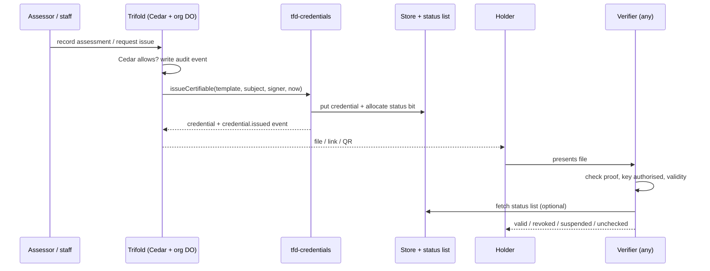

# URLU certificates: portable, self-verifiable credentials

> Trifold should issue the URLU Institute's certificates (Participant, Coach, Mediator) as portable, self-verifiable
> credentials, using one library that Trifold, the Buzz repo and buzz-school can all import, with storage that differs
> per consumer and verification that does not.

## Problem

B4 Uni is planning a three-level URLU certification path (Participant free; Coach and Mediator paid one-time filings;
a small yearly fee to stay on a public roll). Nothing today tracks a certificate: not who earned it, whether it is still
current, or how an outsider checks it. A bare PDF or a database row proves nothing to a school, a court roster or an
employer, and it cannot be moved to another system. The families and co-ops who earn these need a file they keep, and
the verifier needs to check it without trusting Trifold's database or phoning home.

## Goals / Non-goals

Goals:
- Issue each certificate as an Open Badges 3.0 credential on W3C VC 2.0, signed with a Data Integrity proof.
- Make verification need only the file, the issuer's public key and (optionally) a status list.
- Pass 1EdTech's public validator now, and keep the path to official certification open.
- One library, injected storage and signing, identical verify logic in Trifold, Buzz and buzz-school.
- Revoke or suspend a credential, and renew the yearly "on the roll" standing, without reissuing the achievement.

Non-goals:
- Holding keys for holders (no custodied nsec, no wallet that signs for people).
- PDF or PNG badge baking, OpenID4VCI, KERI, GNAP, Nostr badges (all later, none block this).
- Deciding who may issue or revoke (Cedar and delegation decide that; the library records the actor).

## Users & scenarios

- **Dana, a co-op coordinator**, earns a Participant certificate for free, downloads the file, and shows the link to a
  parent group. She never needs an account to share it.
- **Marcus, a mediator**, buys the Mediator filing, passes an assessed practice session, gets the certificate, and pays
  the yearly roll fee. His standing credential lapses if he stops paying; the achievement does not.
- **A court roster clerk** pastes a certificate link and sees level, issue date, status and "Certified by the URLU
  Institute", with no personal data beyond what Marcus chose to show.
- **An assessor or a firm acting under delegation** records an assessment or revokes a credential; the audit event names
  them and who they acted for.

## Workflow

## Spec table

| ID | Rule | Limit | Inputs → outputs |
|---|---|---|---|
| R-1 | Credentials are OB3 on VC 2.0 with the OB3 3.0.3 and VC v2 contexts bundled; no context is fetched at runtime and unknown contexts are refused | Library core | template + subject → credential JSON |
| R-2 | Certifiable credentials carry an `eddsa-rdfc-2022` proof; a proof set puts rdfc first; `eddsa-jcs-2022` is never the only proof on a credential called certifiable | 1EdTech checks the first proof only | credential → proof set |
| R-3 | The issuer is the URLU Institute, identified by a `did:web`; the signing key must appear in that DID document's `assertionMethod` | Key rotation keeps old `key_id`s resolvable | DID doc + proof → key authorised / not |
| R-4 | Signing goes through an injected `Signer`; the library never receives a private key | KMS-held and org-held keys both work | bytes → signature |
| R-5 | Revocation and suspension use Bitstring Status Lists, minimum 131,072 entries, random index allocation, one `credentialStatus` per credential | Achievements default to revocation, standing to suspension | credential + index → status list bit |
| R-6 | A verifier with no status resolver reports `unchecked`, never `valid` | Offline means "valid when issued, status unchecked" | credential → verdict |
| R-7 | The achievement is permanent; the yearly "on the roll" standing is a separate credential with `validUntil` about one year out | Lapse of standing never revokes the achievement | payment event → standing credential |
| R-8 | The public view returns level, achievement name, issue date, `validUntil`, status and issuer name only; the subject name needs an explicit flag | No email, no birth date, no child data by default | verify result → public projection |
| R-9 | Storage is a port (`CredentialStore`, `StatusListStore` with put-if-match); each adapter must pass the shared contract suite | Memory and ObjectStore adapters ship; SQLite/DO is the consumer's | store → contract result |
| R-10 | Issue, revoke, suspend and reinstate each return an audit event with `actor` and optional `onBehalfOf`, no PII | The caller persists it | action → event |
| R-11 | `src/` runs unchanged in Bun, Node, Workers and browsers: no `node:`, `Buffer`, `eval` or `new Function` | Enforced by a test | n/a |
| R-12 | Default text says "Certified by the URLU Institute"; the word "licensed" appears nowhere in defaults or fixtures | Wording is a legal claim limit | template → text |
| R-13 | The default verifier is a strict URLU profile; a looser profile for third-party OB3 is opt-in | Today 3 of 67 external samples verify | credential + profile → verdict |
| R-14 | Holder binding is off by default (`credentialSubject.id` optional); holders may include children | `did:key` binding is a later option | subject → credential |

## Acceptance criteria

- **AC-1** An achievement credential issued with `issueCertifiable` passes 1EdTech's public validator with no errors (a warning that the issuer URL is unreachable is allowed).
- **AC-2** `issueCertifiable` attaches an `eddsa-rdfc-2022` proof by default and never lists `eddsa-jcs-2022` first.
- **AC-3** Changing any signed field, the context, the proof or the verification method is rejected by our verifier, the 1EdTech validator and DCC `verifier-core`.
- **AC-4** Setting the revocation bit with put-if-match, then re-verifying, reports `revoked` in our verifier and in the DCC verifier, and the 1EdTech validator raises a fatal "revoked".
- **AC-5** Verifying with no status resolver returns `unchecked`, never `valid`.
- **AC-6** The public view omits the subject name unless the caller passes `includeName`.
- **AC-7** The in-memory store and the ObjectStore adapter (over atm's `FolderStore`) both pass the shared contract suites.
- **AC-8** A suspended credential is reported `suspended` by our verifier and the DCC verifier, and the limitation that the 1EdTech validator does not flag suspension is documented.
- **AC-9** The official 1EdTech conformance suite passes for an issuer using a real `did:web` domain.
- **AC-10** A browser or Buzz client verifies a certificate using only the file, the issuer key document and an optional status list fetch.
- **AC-11** The opt-in looser profile verifies the DCC and 1EdTech sample credentials that use `did:key` (today 3 of 67 verify).
- **AC-12** buzz-school's SQLite or Durable Object store passes `statusListStoreContract`.
- **AC-13** The package declares a license and the Buzz repo can install it from a release tarball.

## Edge cases

| Case | What happens |
|---|---|
| Two proofs, second one corrupted | Our verifier rejects it; the 1EdTech validator and DCC do not notice (they check or support only the first/known suite) |
| Credential with only `eddsa-jcs-2022` | Our verifier accepts; 1EdTech, DCC and `openbadgeslib` reject it as unsupported |
| Context URL copied to another host | Rejected by us and 1EdTech; accepted by DCC |
| Status list served unreachable | `unchecked`, never `valid` |
| Replayed old status list | Looks current (lists have no `validUntil`), documented risk |
| Yearly roll fee lapses | Standing credential expires by `validUntil`; achievement stays valid |
| Two staff revoke at once | Put-if-match makes the second writer retry; no bit is lost |
| Holder is a child | No name on the public view, no holder key, guardian opt-in for any listing |

## Risks

| Risk | Mitigation |
|---|---|
| The official suite differs from the public validator and fails us | Run the official suite early, on a real domain, before any promise |
| Suspension is invisible in 1EdTech's validator | Use revocation for anything that must show there |
| Children's data on a public verify page | Level, date and status only; counsel review before launch |
| Signing key lost or leaked | Key rotation with kept `key_id`s; decide custody and key-revocation procedure |
| Old status list replayed | Add `validUntil` to status lists or serve them with a short cache lifetime |
| `jsonld` dependency size and upkeep | rdfc lives behind its own subpath so verify-only clients stay at 22 KB gzipped |

## Open questions

See the sidecar (Q1 to Q5): the certifiable proof default, the issuer DID's home, the verifier profile, the license,
and whether to pursue 1EdTech certification now.

## Out of scope

Holder wallets that sign, PDF or PNG baking, OpenID4VCI, KERI, GNAP, Nostr badges, `ecdsa-sd-2023`, who may revoke
(Cedar decides), payment handling.
